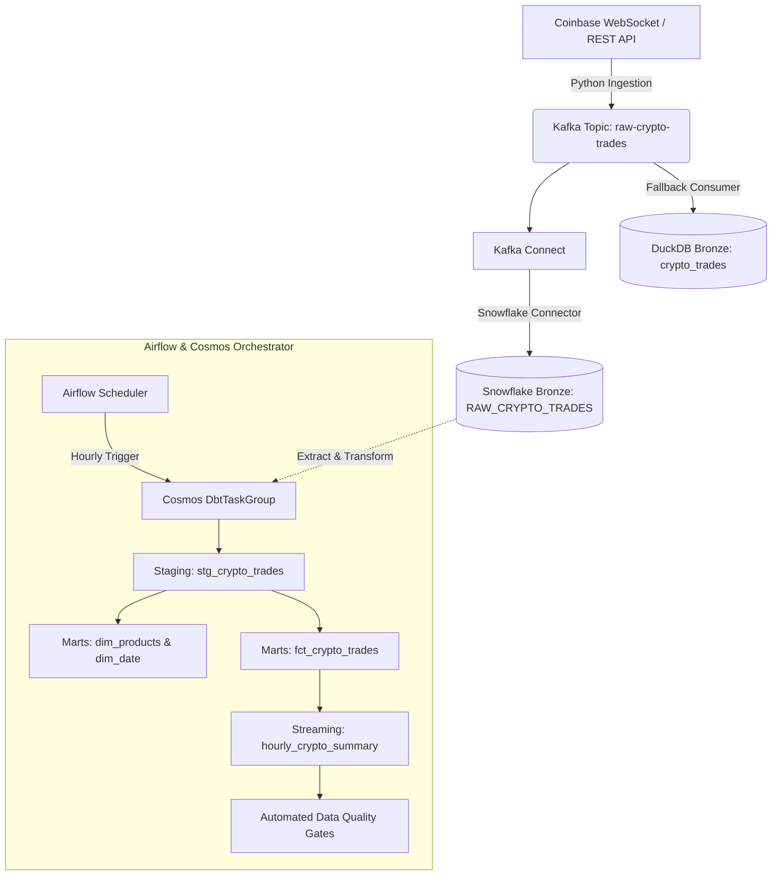

# Crypto Kafka-Snowflake Streaming Pipeline

An end-to-end, production-grade streaming and analytics pipeline that ingests real-time cryptocurrency trade data from the Coinbase WebSocket and REST APIs, buffers and partitions it through Apache Kafka, sinks the data into Snowflake and DuckDB, and orchestrates dimensional modeling and data quality gates using **Apache Airflow** and **Astronomer Cosmos** (replacing dbt Cloud).

---

## Architecture Overview



---

## Project Structure

This repository follows standard modular enterprise data engineering practices:

```text
├── README.md                      # Project overview, architecture, runbooks, and SLAs
├── .env.example                   # Environment configuration template
├── .gitignore                     # Git ignore rules for credentials, caches, and artifacts
├── docker-compose.yml             # Single-command stack: Airflow, Postgres, Kafka, Kafka Connect, Kafka UI
├── Dockerfile                     # Custom Airflow image with dbt-snowflake, Cosmos, and ingestion dependencies
├── pyproject.toml                 # Modern Python packaging and linting configurations
├── Makefile                       # Unified CLI commands for running and testing the stack
├── .github/
│   └── workflows/
│       ├── ci.yml                 # Lint (ruff, sqlfluff), unit tests (pytest), and dbt validation on PR
│       └── deploy.yml             # Container build and deployment validation on merge to main
└── src/
    ├── ingestion/                 # Data extraction and streaming modules
    │   ├── kafka_producer.py      # Kafka producer with deliver reports and serialization
    │   ├── websocket_client.py    # Coinbase WebSocket listener for live trade matches
    │   ├── api_extractor.py       # Idempotent REST API extractor for backfill & historical batches
    │   ├── kafka_consumer.py      # DuckDB bronze consumer (idempotent ON CONFLICT)
    │   ├── config.py              # Configuration loader
    │   ├── logger.py              # Centralized logging format
    │   └── main.py                # Live producer entrypoint
    ├── dags/                      # Airflow DAG definitions
    │   ├── crypto_analytics_dag.py# Hourly pipeline using Cosmos to orchestrate dbt models & tests
    │   └── backfill_dag.py        # Parameterized historical backfill pipeline
    ├── transform/                 # Self-contained dbt project
    │   ├── dbt_project.yml        # dbt project settings and model configurations
    │   ├── profiles.yml           # Snowflake target connection profiles
    │   ├── .sqlfluff              # SQL linting rules for Snowflake dialect
    │   ├── models/
    │   │   ├── staging/           # View layer: stg_crypto_trades
    │   │   ├── intermediate/      # Ephemeral/view staging logic
    │   │   ├── marts/             # Business models: dim_products, dim_date, fct_crypto_trades
    │   │   └── streaming/         # Real-time rollup: hourly_crypto_summary
    │   ├── macros/                # Custom SQL macros
    │   ├── seeds/                 # Reference seed data
    │   └── tests/                 # dbt singular and generic tests
    ├── tests/                     # Unit and data quality tests
    │   ├── test_payload_schema.py # Pydantic schema validation tests
    │   ├── test_producer.py       # Kafka producer mocking and client tests
    │   ├── test_transforms.py     # Python unit tests for transformation logic
    │   └── data_quality.yml       # Automated data quality checks suite
    └── infra/                     # Infrastructure as Code (Terraform)
        ├── main.tf                # Snowflake warehouse, database, schema, and role definitions
        └── variables.tf           # Terraform input variables
```

---

## Services & Ports

| Service | Container Name | Port | Description |
| :--- | :--- | :--- | :--- |
| **Airflow Webserver** | `crypto-airflow-webserver` | [http://localhost:8085](http://localhost:8085) | Airflow UI (`admin` / `admin`) |
| **Kafka UI** | `crypto-kafka-ui` | [http://localhost:8080](http://localhost:8080) | Topic inspection, consumer groups, connector status |
| **Kafka Broker** | `crypto-kafka` | `localhost:29092` / `kafka:9092` | KRaft-mode Kafka cluster |
| **Kafka Connect** | `crypto-kafka-connect` | [http://localhost:8083](http://localhost:8083) | Snowflake Sink Connector runtime |
| **Postgres** | `crypto-postgres` | `localhost:5432` | Airflow metadata database |

---

## Quickstart Guide

### 1. Prerequisites
- Docker & Docker Compose (v2.20+)
- Python 3.9+

### 2. Environment Setup
```bash
cp .env.example .env
python3 -m venv venv
source venv/bin/activate
pip install -r requirements.txt
```

### 3. Launch the Stack
Run the entire infrastructure (Kafka, Kafka Connect, Kafka UI, Postgres, Airflow) with one command:
```bash
make up
```

Wait ~30 seconds for the containers to initialize, then access:
- **Airflow Webserver**: [http://localhost:8085](http://localhost:8085) (Username: `admin`, Password: `admin`)
- **Kafka UI**: [http://localhost:8080](http://localhost:8080)

### 4. Start Streaming Ingestion
In a new terminal:
```bash
make producer
```
To run the local DuckDB fallback consumer concurrently:
```bash
make consumer
```

Or run an idempotent REST API batch extraction:
```bash
make extract-api
```

### 5. Running & Testing Transformations
Trigger dbt transformations directly or let Airflow schedule them:
```bash
make dbt-run
make dbt-test
```

Run Python unit and schema tests:
```bash
make test
```

Lint SQL models:
```bash
make lint
```

---

## Airflow Orchestration (Cosmos)

Instead of relying on external SaaS scheduling (dbt Cloud), transformations are orchestrated locally or on Kubernetes using **Astronomer Cosmos**:
- **Native Task Mapping**: Each dbt model (`stg_crypto_trades`, `dim_products`, `dim_date`, `fct_crypto_trades`, `hourly_crypto_summary`) is rendered as an independent node in the Airflow DAG graph.
- **Granular Retries & Logs**: Failed models can be retried individually without re-running the entire project.
- **Embedded Testing**: Data tests are executed after each layer (`TestBehavior.AFTER_EACH`).
- **Backfill Capability**: Use `backfill_dag` from the Airflow UI to reprocess custom date ranges with custom flags.

# kill all processes
make kill-airflow

# Startup airflow http://localhost:8088
make airflow-up


# View live logs from webserver & scheduler
make airflow-logs

# Stop Airflow containers cleanly
make airflow-down

# Stop everything including Kafka & Postgres
make down
